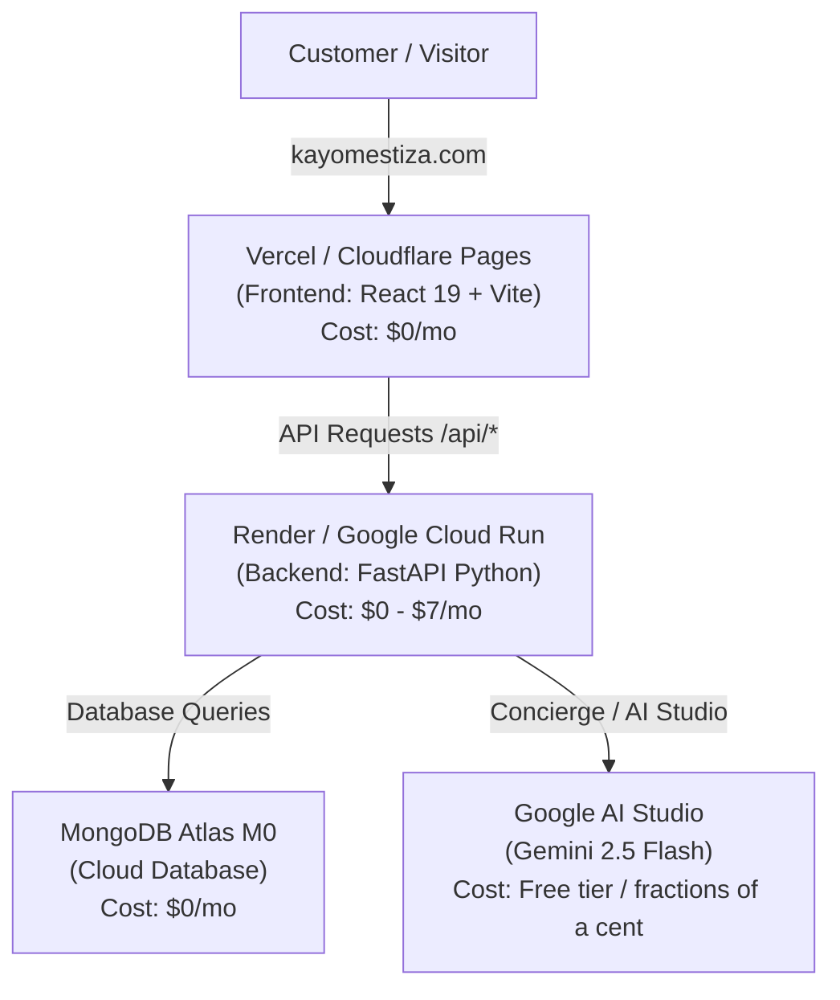

# Kayo Mestiza: Free & Low-Cost Hosting Guide

This guide walks through deploying **Kayo Mestiza** independently to free and low-cost platforms (Vercel, MongoDB Atlas, Render / Google Cloud Run).

---

## Architecture Overview



---

## Step 1: Database Setup (MongoDB Atlas — Free Forever)

1. Sign up or log into [MongoDB Atlas](https://www.mongodb.com/cloud/atlas).
2. Click **Create a Deployment** and choose the **M0 Free** tier.
3. Choose a cloud provider and region closest to your audience (e.g., AWS `us-east-1` in Virginia).
4. Under **Database Access**, create a user (e.g. `kayo_admin`) with a secure password.
5. Under **Network Access**, click **Add IP Address** and select **Allow Access from Anywhere** (`0.0.0.0/0`) so your backend can connect.
6. Click **Connect** → **Drivers** → copy the connection string. It will look like:
   ```text
   mongodb+srv://kayo_admin:<password>@cluster0.abcde.mongodb.net/?retryWrites=true&w=majority
   ```

---

## Step 2: Backend API Hosting (Render or Cloud Run)

### Option A: Render (Easiest — Free or \$7/mo)
1. Sign up or log into [Render.com](https://render.com).
2. Click **New +** → **Web Service**.
3. Connect your GitHub repository (`msagehring/kayomestiza`).
4. Set the configuration:
   - **Root Directory**: `backend`
   - **Environment**: `Python 3` or `Docker`
   - **Build Command**: `pip install -r requirements.txt`
   - **Start Command**: `uvicorn server:app --host 0.0.0.0 --port $PORT`
   - **Plan**: Free (spins down after 15 min of inactivity) or Starter (\$7/mo for instant response).
5. In the **Environment Variables** tab, add:
   - `MONGO_URL`: Your MongoDB Atlas connection string.
   - `DB_NAME`: `kayomestiza`
   - `JWT_SECRET`: A random string (e.g. generate via password manager).
   - `ADMIN_EMAIL`: `eats@kayomestiza.com`
   - `ADMIN_PASSWORD`: A secure password for logging into `/admin`.
   - `CORS_ORIGINS`: `https://kayomestiza.com,https://kayomestiza.vercel.app`
   - `GEMINI_API_KEY`: Your key from [Google AI Studio](https://aistudio.google.com/).
   - `GEMINI_TEXT_MODELS`: `gemini-2.5-flash,gemini-2.0-flash`
6. Click **Deploy Web Service**. You will get an API URL like `https://kayomestiza-api.onrender.com`.

---

## Step 3: Frontend Hosting (Vercel — Free)

1. Sign up or log into [Vercel](https://vercel.com).
2. Click **Add New...** → **Project** and import `msagehring/kayomestiza`.
3. Set the configuration:
   - **Root Directory**: Click edit and select `frontend`.
   - **Framework Preset**: `Vite`
4. In **Environment Variables**, add:
   - `VITE_API_BASE_URL`: Your hosted backend URL from Step 2 (e.g. `https://kayomestiza-api.onrender.com`).
5. Click **Deploy**. Vercel will build and assign you a free `kayomestiza.vercel.app` domain.
6. Under **Settings → Domains**, add `kayomestiza.com` and follow the DNS prompt to point your domain.

---

## Step 4: AI Menu Concierge Key (Google AI Studio)

1. Go to [Google AI Studio](https://aistudio.google.com/).
2. Click **Get API key** → **Create API key**.
3. Paste the key into your backend environment variable `GEMINI_API_KEY`.
   - Gemini 2.5 Flash is extraordinarily fast and cheap (free tier covers up to 15 requests per minute, which is more than enough for customer traffic).
